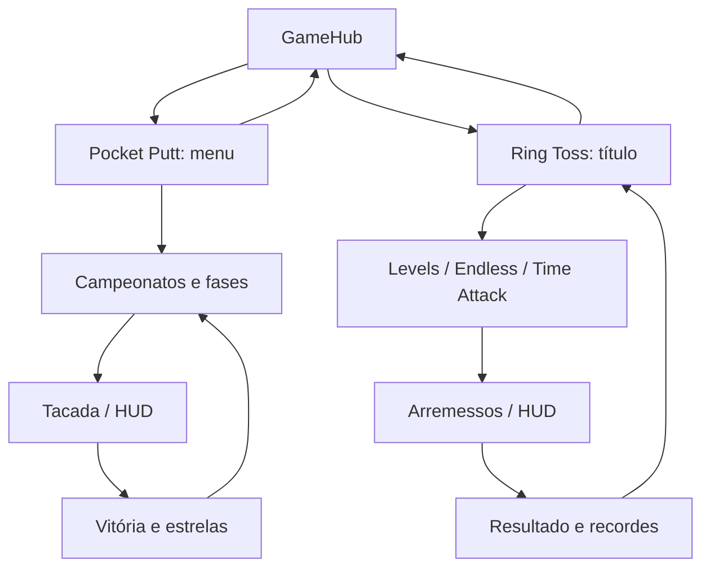

# GameHub — Documento de Design de Jogo (DDE)

**Design · Dynamics · Experience | Jogos Digitais — Insper**  
**Projeto 3D:** GameHub — Pocket Putt & Ring Toss  
**Integrantes:** Nicholas Thuesen, Gabriel Ribeiro, Alison Araujo e Felipe Bakowski  
**Data:** 25 de novembro de 2026 · **Versão documental:** 1.0  
**Unity:** 6000.5.9f1 · URP · WebGL / Windows  
**Referência de implementação:** [69d199f](https://github.com/NThuesen/jogos-digitais-3D/commit/69d199fbfe648d4fed8ca11e19623119c4b0334d)

**Acesso:** [Jogar no itch.io](https://nthuesen.itch.io/gamehub-3d) · [Código-fonte](https://github.com/NThuesen/jogos-digitais-3D) · [GDD técnico](GDD.md)

> A análise segue o framework DDE utilizado na disciplina: Design (Blueprint, Mechanics, Interface), Dynamics (Player–Player, Player–Game, Game–Game) e Experience (Sentidos, Emocional, Intelectual, Percepção). O documento diferencia regras implementadas, dinâmicas derivadas e experiências desejadas. As últimas são hipóteses de design, não resultados de pesquisa com jogadores.

## Resumo executivo

GameHub reúne dois jogos 3D de habilidade em um único aplicativo Unity. Pocket Putt transforma direção e força de uma tacada em desafios de trajetória, com 50 campos organizados em cinco copas, estrelas e troféus. Ring Toss usa arremesso de argolas e resolução física em 50 fases autorais cadastradas, além de rodadas geradas com vidas ou relógio. Seus modos oferecem metas distintas a partir do mesmo gesto.

O hub organiza a escolha, preserva a identidade de cada jogo e permite alternar sem reiniciar o aplicativo. A conexão entre ambos não é uma economia compartilhada ou narrativa comum: é uma experiência de acesso e domínio de gestos simples em desafios espaciais distintos. A ideia central é que **o jogador perceba que melhorar depende de entender a física e calibrar sua ação**, enquanto os sistemas de progressão reconhecem essa melhoria.

## 1. O DDE como instrumento de projeto

O Design explicita o que a equipe construiu: mundo, regras e meios de interação. Dynamics estuda como essas regras se combinam durante a partida, tanto pela ação humana quanto pelo funcionamento dos próprios sistemas. Experience trata da percepção sensorial, emocional e intelectual que essa interação procura produzir. Uma intenção de diversão não basta: é preciso indicar quais decisões de design sustentam essa intenção.

| Camada | Questão aplicada ao GameHub |
|---|---|
| Design | O que se controla, quais são as metas e como as informações aparecem? |
| Dynamics | Que decisões, riscos e comportamentos surgem quando essas regras são executadas? |
| Experience | Que sensações, emoções, aprendizagens e interpretações a experiência procura gerar? |

# PARTE I — DESIGN

## 2. Blueprint: identidade, mundo e intenção

### 2.1 Conceito e diferencial

O conceito reúne duas expressões de precisão 3D. Pocket Putt propõe resolver um problema espacial de baixo ritmo, em que cada tacada importa. Ring Toss alterna entre planejamento de lançamentos e pressão por recursos, em um ambiente de feira. O hub é a infraestrutura de escolha que aproxima esses gêneros sem destruir suas particularidades.

### 2.2 Ambientação e narrativa emergente

No minigolfe, o percurso tem início no Jardim e segue para Dunas, Glacial, Oficina e Mestres. A narrativa emergente é a carreira de um competidor: aprender o gesto, resolver obstáculos, qualificar-se para uma final e ganhar troféus. No Ring Toss, o estande de feira e suas paletas situam a atividade; o arco pessoal é dominar a mira, superar tabuleiros e conquistar recordes. Não há enredo linear compartilhado, combate entre personagens ou diálogos como sistema central.

### 2.3 Público, formato e sessão

O público pretendido é casual e inclui quem avalia o projeto no navegador. A sessão pode começar por uma fase curta ou continuar até uma copa inteira ou uma run de argolas. O gesto de arrastar e soltar reduz a quantidade de comandos necessários. O hub oferece acesso direto aos dois jogos; a edição acadêmica não requer pagamento nem anúncios reais. O suporte a toque existe no design, mas testes em dispositivos físicos variados continuam uma avaliação distinta.

### 2.4 Agência do jogador

A agência está em decidir a direção, a intensidade e o momento de soltar, avaliar alternativas e lidar com consequências. No minigolfe, a trajetória pode ser construída com rebotes ou rotas de segurança. Na feira, o jogador escolhe qual alvo abordar e como ajustar alcance e lateralidade. O jogo fornece indicadores e resultados sem substituir a decisão de lançamento por uma escolha automática de solução.

### 2.5 Direção de arte e linguagem sonora

O Pocket Putt usa campos miniaturizados, cores por tema, formas legíveis, câmera alta e ícones de progresso. O Ring Toss tem ambientação de feira, pinos, argolas, paletas e efeitos de impacto. O hub usa cartões ilustrados por imagens dos próprios jogos. O som reforça o impacto, o acerto e a progressão, enquanto o Time Attack emprega tensão associada ao relógio. O objetivo visual comum é legibilidade de ações e estados, não uniformizar as duas artes.

## 3. Mechanics: regras, ações e sistemas

### 3.1 Escolha e ciclos fundamentais

| Sistema | Entrada | Processamento | Saída |
|---|---|---|---|
| Hub | Selecionar cartão | Trocar cena e ajustar viewport | Jogo escolhido |
| Pocket Putt | Arraste contrário à tacada e soltura | Direção, força, atrito, colisões e buraco | Nova posição ou conclusão |
| Ring Toss | Arraste para cima e ajuste lateral | Lançamento, trajetória, pino e resultado | Pontuação e atualização de recurso |
| Progressão | Conclusão e recordes | Aplicar regras próprias de cada jogo | Desbloqueios e registros locais |

### 3.2 Pocket Putt: controle e física

A tacada é manual: o jogador puxa no sentido oposto ao movimento desejado, com potência proporcional ao arraste e limite máximo. A simulação resolve a bola até repouso ou conclusão; obstáculos sólidos podem desviar a trajetória, superfícies alteram desaceleração, portais transportam a bola e obstáculos móveis exigem leitura temporal. A água termina a tacada e devolve a bola ao tee sem apagar a penalidade. O buraco exige condições de captura de posição e velocidade.

### 3.3 Pocket Putt: progressão, vitória e repetição

Cada fase concede de uma a três estrelas ao ser concluída, conforme seus limiares de tacadas. Cada copa tem nove classificatórias e uma final; para habilitar a final é preciso concluir as nove e somar pelo menos 13, 15, 17, 18 ou 20 estrelas, respectivamente. Vencer a final dá um troféu e libera a próxima copa. O jogador pode repetir as fases para melhorar estrelas e melhores tacadas. As estrelas não são consumidas. O ciclo de 50 fases permite acumular até 150 estrelas e cinco troféus.

### 3.4 Ring Toss: lançamento e resolução física

O gesto vertical controla o lançamento para frente e a componente lateral define a mira. A argola percorre uma trajetória sujeita às condições do tabuleiro. Perfect Ringer e Ringer são sucessos; Bounce e Miss representam falha de encaixe. Vento, rajadas, escala da argola, oscilação e pinos móveis variam a margem para executar o gesto. A prévia de trajetória ajuda na estimativa sem abolir a necessidade de execução.

### 3.5 Ring Toss: três formas de desafio

- **Levels:** tabuleiros autorais com quantidade limitada de argolas; capturar todos os pinos conclui a fase. Argolas restantes determinam estrelas adicionais. Há 50 configurações de fase cadastradas, em cinco grupos temáticos.
- **Endless:** inicia com três vidas. Erros retiram vidas e rompem a sequência de perfeitos; cinco perfeitos acumulados sem erro recuperam uma vida até o máximo de três, ou geram bônus de score se o jogador já estiver no máximo. Rodadas são geradas e o jogo termina ao esgotar vidas.
- **Time Attack:** começa com 30 segundos e tem teto de 45. Acerto perfeito acrescenta 2,5 s; comum, 1,2 s; completar rodada, 4 s. Erro retira 3 s. A taxa de drenagem aumenta até 1,6 s por segundo. O término ocorre ao zerar o relógio.

### 3.6 Ring Toss: economia e recompensas

Tickets recompensam precisão e progresso. Acerto perfeito rende 3; primeira conclusão de fase, 15 + 10 por estrela; replay, 3 + 2 por estrela. Rodadas e runs também têm recompensas próprias. O jogador pode adquirir e equipar cosméticos. Os fluxos de anúncio são simulados na edição acadêmica, e a regra de compartilhamento é condicionada à disponibilidade e ao intervalo. Não há moeda compartilhada com o minigolfe nem anúncios de produção. As tabelas completas estão no [GDD](GDD.md#26-ring-toss-tickets-e-personalização).

### 3.7 Persistência e condições de encerramento

Pocket Putt conserva melhores resultados, troféus e desbloqueios em JSON; Ring Toss conserva progresso, recordes, tickets e cosméticos via PlayerPrefs. A troca de jogo não converte nem consome esses recursos. A partida termina conforme o objetivo da fase ou o esgotamento de seu recurso específico; replay e retorno ao hub permitem continuar em outra sessão. O armazenamento é local, inclusive no navegador, e não garante recuperação se os dados forem apagados.

## 4. Interface: como o jogo comunica e recebe ações

### 4.1 Jornada de telas

A navegação é parte do design: o retorno explícito ao hub evita que escolher um jogo seja uma decisão irreversível. A placa BACK TO HUB do Ring Toss e a ação Voltar ao hub do Pocket Putt comunicam o mesmo destino usando a linguagem visual de cada jogo.

### 4.2 Controles, feedback e hierarquia

O hub usa cartões com rótulo e ação Jogar. Pocket Putt mostra contador de tacadas, estrelas-alvo, título da fase, voltar, reiniciar e tutorial. Ring Toss apresenta modos e loja, pontuação e recursos de cada partida. Indicações de mira ou trajetória são feedback prospectivo; efeitos de impacto, pontos, estrelas e troféus são feedback retrospectivo. Os dois são necessários: o primeiro auxilia a decisão, o segundo ensina a avaliar seu resultado.

### 4.3 Legibilidade e adaptação de tela

A integração inicialmente expandia todo o canvas WebGL, deformando a composição do minigolfe vertical. O hotfix fixa o canvas inteiro do Pocket Putt em 9:16 centralizado para manter UI, câmera e input na mesma geometria. O hub e Ring Toss retomam área responsiva ao sair. A atualização do botão Ring Toss substitui texto pequeno e fundo translúcido por placa opaca e texto claro. Essas decisões preservam a informação em vez de alterar as mecânicas. Contraste, escala, mouse e toque são preocupações de usabilidade; não se reivindica certificação formal de acessibilidade.

# PARTE II — DYNAMICS

## 5. Player–Player: escopo e ausência deliberada

Os jogos são single-player. Não há adversário humano simultâneo, ranking online ou troca de recursos entre jogadores implementados nesta edição. Portanto, a categoria Player–Player tem alcance restrito: comparação informal de estrelas ou recordes e demonstração a colegas são possibilidades sociais externas, não mecânicas documentadas. A ausência de competição direta permite que a experiência seja centrada em progresso pessoal. A comparação informal é hipótese de uso, não evidência de interação medida.

## 6. Player–Game: como escolhas se tornam habilidade

### 6.1 Experimentação e ajuste no minigolfe

O gesto oferece duas variáveis contínuas, força e ângulo. Uma tacada direta pode falhar se o obstáculo interceptar o trajeto ou a velocidade final for excessiva. O jogador passa a observar posições, imaginar um rebote, dosar a força e verificar se a hipótese funcionou. Ao reiniciar ou repetir, pode mudar uma variável por vez. O recorde e as estrelas dão uma medida de eficiência, não apenas de passagem.

### 6.2 Decisões sob risco

A areia favorece a redução de velocidade; o gelo prolonga o movimento. Uma rota por água arrisca perder uma tacada e retornar ao início. Portais e obstáculos móveis oferecem alternativas que exigem compreensão espacial e temporal. Assim, a escolha pode ser entre uma rota longa e segura e uma curta, porém exigente. Não é necessário que exista uma única solução ótima humana.

### 6.3 Domínio do arremesso

No Ring Toss, o jogador aprende a relacionar a altura e a lateralidade do gesto com o local de chegada. A prévia auxilia a estimativa; vento e movimento exigem compensação. O feedback distingue um encaixe limpo de uma recuperação e de um erro, permitindo aprender com resultados qualitativamente diferentes. Um alvo fácil pode ser uma escolha prudente antes de um alvo difícil.

### 6.4 Gestão de recursos por modo

Em Levels, as argolas restantes criam incentivo de eficiência; em Endless, a vida representa tolerância ao erro e a sequência de perfeitos pode restaurá-la; em Time Attack, a escolha entre mirar com calma e agir depressa é constantemente relevante. Os mesmos movimentos produzem dinâmicas diferentes porque o custo do erro muda. A loja de cosméticos prolonga o interesse sem transferir recursos ao Pocket Putt.

### 6.5 Escolha de ritmo e autonomia

O hub permite optar entre o planejamento de um campo e a atividade de feira, voltar e retomar depois. Essa liberdade pode reduzir saturação e dar autonomia ao jogador. Como os saves são separados, escolher outro jogo não obriga abrir mão do progresso já obtido.

## 7. Game–Game: sistemas que interagem independentemente do jogador

| Sistemas em interação | Dinâmica resultante |
|---|---|
| Potência × atrito × colisões × captura do buraco | A trajetória e o repouso variam; força máxima não é sempre ótima |
| Água × contador de tacadas × posição inicial | Erro espacial tem consequência na eficiência mesmo após reset da bola |
| Obstáculos móveis × relógio da simulação | A janela de passagem muda ao longo do tempo |
| Tacadas × estrelas × desbloqueio de final | O resultado local influencia a campanha, e o replay pode abrir novas metas |
| Argola × pino × vento × colisão | O resultado de um lançamento emerge de sua trajetória física |
| Resultado × recurso do modo × fim da partida | O mesmo erro tem consequência distinta em Levels, Endless e Time Attack |
| Perfeitos × limite de vidas × bônus | Recuperação recompensa precisão sem permitir acumular vidas indefinidamente |
| Acertos × bônus de tempo × drenagem crescente | Sucesso prolonga a run, enquanto a dificuldade temporal aumenta |
| Conclusão × tickets × loja × save | Resultados são convertidos em progresso cosmético persistente |
| Cena × viewport × áudio × armazenamento | Alternância de jogos exige restaurar estado compartilhado sem misturar progresso |

Aqui Game–Game descreve a interação entre sistemas do jogo, e não simplesmente a existência de dois minigames. O hub também possui essa dinâmica técnica: uma alteração de cena deve modificar a apresentação sem mudar as regras de cada jogo.

## 8. Dinâmicas emergentes: situações exemplares

**Situação A — ricochete no minigolfe.** Um bloco impede a linha direta. O jogador tenta a lateral, erra o ângulo e observa onde a bola parou. Ajusta a segunda tentativa e conclui com menos tacadas. A regra de colisão e a métrica de eficiência geram experimentação. A sensação pretendida é de descoberta, não de sorte.

**Situação B — sobrevivência no Ring Toss.** Uma run Endless está com duas vidas. Acertos perfeitos sem novo erro acumulam o marco para recuperar uma vida. O jogador alterna alvos de execução segura e lançamentos mais exigentes. Uma falha redefine a sequência e reduz a margem de erro. A tensão decorre da combinação entre risco e possibilidade de recuperação.

**Situação C — relógio contra precisão.** Em Time Attack, mirar lentamente reduz o tempo disponível. Acertar rapidamente recupera parte do relógio. O jogador procura um ritmo sustentável conforme as rodadas ficam mais difíceis. O domínio não é apenas motor: envolve decidir quanto tempo investir em cada arremesso.

**Situação D — troca voluntária de experiência.** Após várias tentativas no minigolfe, o jogador retorna ao hub e escolhe Ring Toss. Ao retornar mais tarde, suas estrelas continuam registradas. O valor é poder variar o ritmo sem perder continuidade. Os cenários são análises das regras, não transcrições de partidas humanas observadas.

# PARTE III — EXPERIENCE

## 9. Sentidos: o que o jogador vê e ouve

O minigolfe procura clareza de leitura por uma câmera elevada e geometria reconhecível. O movimento da bola e os efeitos de colisão, água e buraco comunicam o que ocorreu. O Ring Toss enfatiza profundidade, arco do lançamento, luzes do estande, movimento de alvos e efeitos de acerto. O som e a animação reforçam o impacto. A interface é projetada para que as informações essenciais permaneçam visíveis: a correção 9:16 evita que a UI do Pocket Putt encubra o campo.

## 10. Emocional: sentimentos pretendidos

- Curiosidade e segurança ao começar com um gesto simples e uma meta clara.
- Tensão moderada ao arriscar uma rota difícil ou mirar com poucas vidas.
- Alívio e satisfação quando a bola encaixa ou a argola captura o pino.
- Orgulho ao melhorar recorde, obter estrelas ou conquistar uma copa.
- Urgência no Time Attack e autonomia ao trocar de jogo.

A equipe pretende que falhas sejam interpretadas como oportunidades de ajuste. Se a trajetória ou a UI forem ilegíveis, a mesma dificuldade pode gerar frustração injustificada. Por isso, feedback e enquadramento são elementos do design, não meros adornos.

## 11. Intelectual: hipóteses, aprendizagem e autoria

O jogador cria um modelo mental das relações força–distância, direção–colisão e velocidade–captura. No minigolfe, aprende a observar superfície e obstáculo antes da tacada; no Ring Toss, a compensar alcance, vento e posição do alvo, além de administrar tempo, vidas ou argolas. O aprendizado emerge da comparação entre intenção e consequência. Recordes permitem avaliar a própria melhoria; as fases introduzem condições novas sem exigir um conjunto totalmente novo de comandos.

## 12. Percepção: interpretação que deve permanecer

A impressão desejada é a de dois jogos independentes, completos em suas regras, reunidos de modo coerente. O jogador deve reconhecer que sucesso não depende de clicar aleatoriamente, mas de controlar e adaptar seus gestos. O hub deve parecer uma porta de entrada funcional, não uma interrupção. A ausência de anúncios reais nesta edição contribui para continuidade da avaliação acadêmica. Não se presume que todo jogador chegue à mesma interpretação; isso é objetivo a testar.

# PARTE IV — CONEXÃO DDE E VALIDAÇÃO

## 13. Matriz de rastreabilidade: Design → Dynamics → Experience

| Design implementado | Dynamics esperada | Experience pretendida | Evidência / teste proposto |
|---|---|---|---|
| Gesto de tacada contínuo | Calibrar ângulo e potência | Agência e domínio | Observar tentativas e correções de direção |
| Superfícies e rebotes | Escolher rota e ajustar força | Descoberta espacial | QA de rotas + comparar estratégias humanas |
| Água e penalidade | Ponderar risco contra eficiência | Tensão justa | Verificar se o jogador entende o retorno e a tacada |
| Estrelas e finais | Repetir fases para qualificar | Progresso e conquista | Testes de desbloqueio + entrevista sobre metas |
| Trajetória de argola | Ajustar mira e alcance | Confiança e aprendizagem | Acertos após tentativas, observação de gesto |
| Perfeitos e vidas | Buscar recuperação sem exceder limite | Alívio e tensão | Teste de regras Endless e compreensão do HUD |
| Drenagem e bônus de relógio | Conciliar velocidade com precisão | Urgência e foco | Teste Time Attack + percepção do ritmo |
| Tickets e cosméticos | Repetição motivada por resultado | Expressão e continuidade | Testes de economia e loja |
| Dois cartões e retorno explícito | Alternar sem perder estado | Autonomia e fluidez | PlayMode de alternância e saves |
| Viewport vertical exclusivo | Manter mira, câmera e UI coerentes | Legibilidade e controle | Edge em quatro resoluções; verificação no itch.io |
| Botão BACK TO HUB opaco | Identificar ação de saída | Orientação e previsibilidade | Edge em retrato e paisagem, clique e toque simulado |

## 14. Jornada exemplar de um jogador

1. Abre GameHub pelo navegador e escolhe Pocket Putt.
2. Inicia C1-01, interpreta a orientação de arraste e conclui a fase; observa estrelas e recorde.
3. Abre Campeonatos e entende o caminho até a final e os requisitos de qualificação.
4. Retorna ao hub e abre Ring Toss; testa uma fase autoral e depois o modo Time Attack.
5. Observa diferenças entre um acerto perfeito, comum e uma falha; decide repetir ou voltar ao menu.
6. Usa BACK TO HUB e volta ao minigolfe, com seu progresso anterior mantido.

A jornada ilustra o fluxo planejado; não implica que um participante real tenha completado exatamente esses passos.

## 15. Evolução do projeto e decisões de design

| Marco | Decisão e motivação |
|---|---|
| Base GameHub recebida | Preservar hub e Ring Toss, atualizando o minigolfe que era um protótipo C1-01 |
| Integração [ccda2c0](https://github.com/NThuesen/jogos-digitais-3D/commit/ccda2c0b3c3aebd907fdd8e643cf0ed260ab1119) | Incorporar campanha completa do Pocket Putt, manter saves separados e serviços de anúncio offline |
| Hub ilustrado [c3f0dff](https://github.com/NThuesen/jogos-digitais-3D/commit/c3f0dffcd86f5023f9f622208f8d1fdbf20d7426) | Reforçar reconhecimento dos jogos e adaptar cartões a retrato/paisagem |
| Hotfix [cd9339a](https://github.com/NThuesen/jogos-digitais-3D/commit/cd9339aa8ab28a2ced548c7b085b7eea4441c261) | Corrigir sobreposição e enquadramento ao preservar canvas 9:16 no Pocket Putt |
| Retorno Ring Toss [69d199f](https://github.com/NThuesen/jogos-digitais-3D/commit/69d199fbfe648d4fed8ca11e19623119c4b0334d) | Tornar explícita e visível a navegação de volta ao hub |

A evolução mostra que a experiência depende da adequação entre design de interação, adaptação de tela e implementação. Compilar não é suficiente para validar legibilidade.

## 16. Evidência, intenção e pendências

### 16.1 Evidências registradas

A integração reportou 166 EditMode, 82 PlayMode, 18 grupos de QA de rotas e uma campanha automatizada de 50 fases com 150 estrelas e cinco troféus. A build Windows original foi gerada com zero erros e 13 avisos, com limitação de automação de clique por foco da janela. O hotfix do minigolfe foi validado no Edge em quatro resoluções; o retorno do Ring Toss foi verificado em três resoluções com mouse e toque simulado. As contagens não representam reexecução integral depois de cada alteração.

### 16.2 Limitações e riscos prioritários

- O teste automatizado histórico de enquadramento de C1-09 permanece conhecido como falho e não foi reexecutado no hotfix; a fase recebeu inspeção visual e pôde ser concluída em cenários de teste.
- Validação local em Edge e commit no GitHub não garantem que o ZIP mais recente tenha sido enviado ao itch.io; verificar a publicação e os dois fluxos.
- Não há dados de playtest humano representativo, métricas de retenção nem certificação de acessibilidade/mobile.
- O pacote Windows anterior pode não conter os últimos ajustes da edição WebGL.

### 16.3 Roteiro curto de playtest sugerido

Solicitar que um participante, sem orientação inicial, abra cada jogo, realize uma ação, reconheça sucesso/erro, identifique o recurso do modo e encontre o retorno ao hub. Depois, pedir uma segunda tentativa de cada jogo, verificar se corrigiu o gesto e perguntar o que aprendeu. Registrar resolução, cliques equivocados, obstáculos de leitura, tentativas, compreensão de recompensas e percepção de controle. Recarregar a página e verificar progresso independente. Esse roteiro é uma proposta de avaliação, não um teste já executado.

## 17. Relação com as rubricas da disciplina

| Rubrica | Onde encontrar a descrição |
|---|---|
| Conceito e narrativa | DDE §2; GDD §1 |
| Mecânicas | DDE §3; GDD §2 |
| Feedback | DDE §4 e §9; GDD §3 |
| Interface | DDE §4; GDD §4 |
| Engajamento e imersão | DDE §6 e §9–12; GDD §5 |
| Level design e progressão | DDE §3 e §6–7; GDD §6 |
| Som e música | DDE §2.5 e §9; GDD §7 |
| Efeitos e polimento | DDE §4.3 e §9; GDD §8 |
| Rejogabilidade | DDE §6.4–6.5; GDD §9 |
| Balanceamento | DDE §7; GDD §10 |
| Estados e erros | DDE §3.7, §4.3 e §7; GDD §11 |
| Documentação | DDE §16–18; GDD §12 |

## 18. Fontes, créditos e atualização

O [GDD](GDD.md) contém tabelas, números e referências diretas aos scripts da implementação. O [README](../README.md) contém instruções de abertura, build, créditos, licenças e proveniência. Os cinco commits citados na evolução registram a integração e os ajustes de apresentação. A organização segue o framework acadêmico DDE utilizado na disciplina, com a mesma distinção metodológica adotada na entrega 2D.

Pocket Putt é creditado a PocketSlop Games e Ring Toss a SlipperyZlope Games, conforme o README. A montagem acadêmica do hub é creditada aos quatro integrantes identificados no cabeçalho. Esta edição mantém anúncios offline e não substitui os projetos de origem.

**Conclusão:** as regras de precisão, os sistemas de progressão e o hub oferecem duas formas complementares de desafio. A rastreabilidade DDE torna explícita a ligação entre o gesto que foi implementado, as decisões que pode suscitar e a experiência que se pretende oferecer. Os resultados técnicos dão suporte à viabilidade, e as hipóteses de experiência permanecem abertas à avaliação humana.
