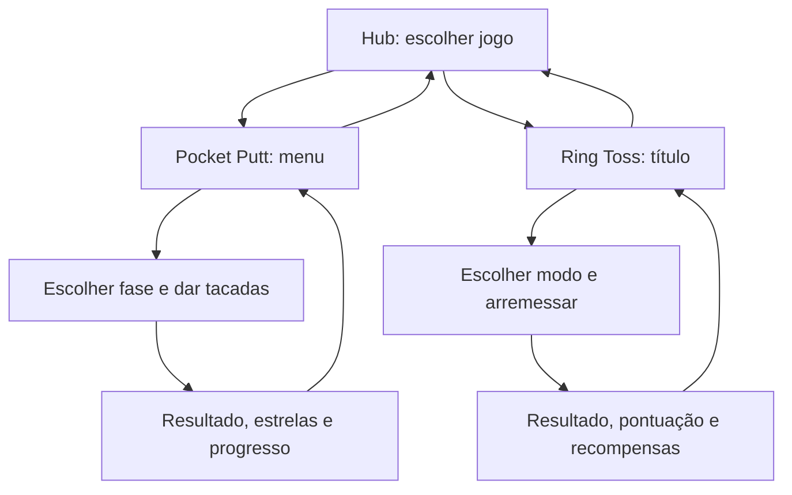

# GameHub — Pocket Putt & Ring Toss | Game Design Document

**Jogos Digitais · Insper · Projeto 3D · 25/11/2026**  
**Integrantes:** Nicholas Thuesen, Gabriel Ribeiro, Alison Araujo e Felipe Bakowski  
**Versão documental:** 1.0 · Unity 6000.5.9f1 · URP · WebGL e Windows

> Este GDD descreve a edição acadêmica integrada, com referência de código no commit [69d199f](https://github.com/NThuesen/jogos-digitais-3D/commit/69d199fbfe648d4fed8ca11e19623119c4b0334d). Para a análise acadêmica segundo Design, Dynamics e Experience, consulte [DDE.md](DDE.md). As experiências pretendidas não equivalem a resultados medidos de playtest humano.

**Jogo:** [GameHub no itch.io](https://nthuesen.itch.io/gamehub-3d) · **Código:** [GitHub](https://github.com/NThuesen/jogos-digitais-3D) · **Execução:** [README](../README.md)

## 1. Blueprint: conceito e narrativa

**Dois desafios de precisão, uma única porta de entrada.** GameHub reúne Pocket Putt (minigolfe) e Ring Toss (arremesso de argolas). O jogador escolhe um dos cartões do hub e entra em um jogo completo, com regras, controles, identidade visual e progresso próprios. Pode retornar ao menu central e trocar de experiência sem reiniciar o aplicativo.

| Dimensão | Pocket Putt | Ring Toss |
|---|---|---|
| Fantasia | Competidor de minigolfe em uma sequência de campeonatos | Visitante de uma feira que aperfeiçoa a pontaria |
| Gênero | Esporte casual, puzzle de física | Arcade de precisão, esporte casual |
| Espaço | Campos miniaturizados e temáticos | Estande de feira com pinos e argolas |
| Motivação | Resolver trajetórias, reduzir tacadas, conquistar copas | Dominar lançamentos, pontuar, superar recordes e completar fases |
| Estrutura | Campanha de 50 fases | 50 fases autorais cadastradas e dois modos de rodadas geradas |

A ambientação não depende de uma narrativa linear com diálogos ou personagens jogáveis. A história é a evolução da habilidade do jogador: de uma primeira tacada ou arremesso simples a desafios de maior exigência. As copas e as paletas de feira comunicam essa mudança de contexto.

**Público pretendido:** jogadores casuais, estudantes e avaliadores, com entrada por mouse ou toque e possibilidade de sessões curtas. A publicação acadêmica prioriza navegador desktop; compatibilidade de todos os dispositivos móveis não foi certificada.

## 2. Mechanics — as mecânicas do jogo

### 2.1 Hub e ciclo de interação

O hub não oferece moeda, placar ou campanha compartilhada. Ele é uma camada de navegação entre experiências independentes.

### 2.2 Pocket Putt: regra da tacada e objetivo

- Objetivo: colocar a bola no buraco usando o menor número possível de tacadas.
- O jogador pressiona a área de jogo, arrasta na direção contrária à trajetória desejada e solta. Direção e força são determinadas pelo mesmo gesto.
- A força é proporcional ao comprimento do arraste, limitada ao máximo; arrastes abaixo da potência mínima cancelam a tacada. A implementação de `GestureMath` calcula a distância de potência máxima a partir da dimensão efetiva da tela.
- Uma tacada válida incrementa o contador. A simulação avança até a bola parar, cair na água ou ser encaçapada. Reiniciar a tentativa zera o contador.
- O encaixe depende de posição e velocidade: alcançar o buraco muito depressa pode não ser suficiente. Em água, a tacada continua contabilizada e a bola volta ao ponto inicial.
- As paredes e obstáculos permitem rebotes; grama, areia e gelo têm desacelerações diferentes. Portais e obstáculos móveis modificam as possibilidades de rota.
- Ao concluir, a fase atribui uma, duas ou três estrelas de acordo com seus limiares de tacadas. A melhor quantidade de estrelas e o menor número de tacadas ficam registrados separadamente.

### 2.3 Pocket Putt: campanha e desbloqueios

Cada copa tem nove classificatórias e uma final. A primeira classificatória fica disponível ao abrir a copa; concluir uma classificatória libera a seguinte. A final exige todas as nove classificatórias concluídas e a pontuação mínima acumulada nelas. Vencer a final concede o troféu da copa e abre a próxima.

| Copa | Tema e desafio predominante | Estrelas mínimas nas classificatórias (máx. 27) |
|---|---|---:|
| C1 — Jardim | Estreia, leitura do campo, força e rebotes | 13 |
| C2 — Dunas | Areia, atrito, rotas seguras | 15 |
| C3 — Glacial | Gelo, inércia, túneis | 17 |
| C4 — Oficina | Engrenagens, obstáculos móveis e timing | 18 |
| C5 — Mestres | Síntese dos desafios | 20 |

São 50 fases, 150 estrelas possíveis e cinco troféus. As estrelas não são dinheiro nem consumidas para abrir fases. A regra de final é persistida, e o jogador pode revisitar fases concluídas para melhorar resultados. As regras estão em [Campaign.cs](../Assets/_PocketPutt/Scripts/Game/Campaign.cs) e [Progress.cs](../Assets/_PocketPutt/Scripts/Game/Progress.cs).

### 2.4 Ring Toss: lançamento e resolução

O jogador pressiona, arrasta para cima e solta para lançar a argola; a componente lateral ajusta a mira. O sistema converte o gesto em velocidade de lançamento e fornece prévia de trajetória. Um gesto insuficiente é cancelado. A argola interage fisicamente com os pinos e pode ser afetada por vento, rajadas, tamanho, oscilação e movimento dos alvos.

| Resultado | Significado |
|---|---|
| Perfect Ringer | Argola desce sobre o pino sem tocá-lo antes |
| Ringer | Argola fica encaixada depois de contato/rebote |
| Bounce | Há contato, mas sem encaixe |
| Miss | Não alcança o pino |

Os dois primeiros resultados contam como sucesso. O valor do pino e o multiplicador do resultado determinam os pontos. O feedback distingue a execução perfeita de um acerto com recuperação e de um erro.

### 2.5 Ring Toss: três modos

| Modo | Recurso | Objetivo | Encerramento |
|---|---|---|---|
| LEVELS | Quantidade de argolas definida pela fase | Capturar todos os pinos do tabuleiro | Concluir o tabuleiro ou esgotar tentativas sem concluir |
| PLAY / Endless | Três vidas iniciais, máximo três | Completar rodadas geradas e obter recorde | Vidas chegam a zero |
| TIME ATTACK | Relógio inicial de 30 s, máximo 45 s | Completar rodadas rapidamente e pontuar | Tempo chega a zero |

Em LEVELS, uma fase concluída concede pelo menos uma estrela; duas e três dependem de quantas argolas ainda restam, conforme a configuração da fase. A conclusão registra resultados e permite avançar. Em Endless, cada erro consome uma vida; cinco acertos perfeitos acumulados sem erro recuperam uma vida se houver espaço. Um ringer comum não rompe a sequência; no limite de vidas o marco gera bônus de pontuação. Em Time Attack, o relógio perde tempo continuamente durante o jogo; acertos perfeitos adicionam 2,5 s, acertos comuns 1,2 s, completar uma rodada 4 s, e erros retiram 3 s. A taxa de drenagem progride de 1 a 1,6 segundo por segundo ao longo das rodadas. Os modos gerados usam tabuleiros progressivamente mais exigentes e guardam recordes próprios.

### 2.6 Ring Toss: tickets e personalização

Tickets são uma moeda interna para adquirir e equipar cosméticos, como aparências de argolas e trilhas. Não são dinheiro real. As regras de `TicketRules` definem recompensas por execução e progresso:

| Evento | Tickets |
|---|---:|
| Acerto perfeito | 3 |
| Primeira conclusão de fase | 15 + 10 × estrelas |
| Repetição de fase concluída | 3 + 2 × estrelas |
| Rodada Endless | 2 + parte inteira de (rodada − 1)/3 |
| Encerramento de run Endless | 4 × rodadas concluídas |
| Fluxo de anúncio recompensado | 20 |
| Compartilhamento recompensado | 12; 24 com multiplicador ativo |

As últimas duas linhas são regras dos fluxos internos, condicionadas às verificações de disponibilidade e intervalo da implementação; não representam anúncios reais nem promessa de funcionamento de compartilhamento nativo no navegador. A edição acadêmica usa anúncios simulados/offline, sem IDs de produção. Pocket Putt não usa tickets do Ring Toss.

## 3. Feedback e clareza de interação

| Ação / acontecimento | Resposta do sistema | Finalidade |
|---|---|---|
| Selecionar cartão | Abrir cena do jogo | Navegação inequívoca |
| Mirar no minigolfe | Indicador de mira e gesto de força | Antecipar direção e potência |
| Tacada e colisão | Movimento, rebote, som e atualização do contador | Conectar ação à consequência |
| Água | Efeito de respingo e retorno ao início | Tornar a penalidade compreensível |
| Buraco e final | Resultado, estrelas, efeitos de celebração e troféu quando conquistado | Confirmar domínio e progresso |
| Mirar argola | Prévia de trajetória | Estimar alcance e direção |
| Acerto / falha de argola | Resolução física e feedback audiovisual específico; pontuação, vidas ou relógio atualizados | Distinguir qualidade do lançamento |
| Compra ou equipar cosmético | Estado de posse e aparência selecionada | Confirmar a recompensa |

O feedback deve ajudar o jogador a diagnosticar o próprio erro, não apenas indicar vitória ou derrota. Vibração, onde disponível, é complementar: não é requisito para compreender o jogo no desktop.

## 4. UI/HUD e menus

| Tela | Informação e ações principais |
|---|---|
| Hub | Dois cartões ilustrados: Pocket Putt e Ring Toss; empilhados em retrato, lado a lado em paisagem |
| Pocket Putt — menu | Estrelas, fase sugerida, Jogar, Campeonatos, Troféus, configurações e Voltar ao hub |
| Pocket Putt — mapa de copa | Fases disponíveis, concluídas ou bloqueadas; estrelas e exigência da final |
| Pocket Putt — partida | Nome/código da fase, contador de tacadas, estrelas-alvo, voltar, reiniciar e tutorial contextual |
| Pocket Putt — resultado | Estrelas, resultado, recorde e ações de continuidade/repetição |
| Ring Toss — título | PLAY, TIME ATTACK, LEVELS, SHOP, tickets, configurações e BACK TO HUB |
| Ring Toss — partida | Pinos, argola, trajetória, pontuação e recurso do modo (argolas, vidas ou tempo) |
| Ring Toss — resultados/loja | Desempenho e recordes; compra/equipamento de cosméticos |

O botão **BACK TO HUB** do Ring Toss usa uma placa roxa opaca, texto explícito e área de interação ampliada. Na partida, **BACK** permite retornar ao título. No Pocket Putt, o retorno ocorre pelo menu inicial. Os dois preservam seu progresso ao trocar de cena.

**Layout WebGL:** a página é responsiva no hub e no Ring Toss; no Pocket Putt o canvas inteiro assume uma área 9:16 centralizada. Isso mantém a UI Toolkit de referência 1080 × 1920, o enquadramento da câmera e as coordenadas dos gestos coerentes. Ao voltar, a área do canvas volta a preencher a janela. A correção evita sobreposição de logotipo, botões e HUD em telas horizontais.

## 5. Engajamento e imersão

Pocket Putt favorece o ciclo observar → traçar estratégia → executar → interpretar → repetir. A unidade de progresso é uma fase curta; estrelas e copas convertem pequenas melhorias em objetivo de longo prazo. O Ring Toss oferece três ritmos: precisão com orçamento de argolas, sobrevivência por vidas e urgência por tempo. O hub permite escolher o ritmo sem abandonar o aplicativo.

O design procura uma sensação de domínio sobre ações simples, mas com resultados variados. Metas visíveis, respostas imediatas e recordes pessoais favorecem motivação intrínseca; troféus e cosméticos dão continuidade entre sessões. A presença desses mecanismos é verificável no código; seu efeito psicológico é intenção de design.

## 6. Level design e progressão

**Pocket Putt.** Os campos são definidos por dados de nível, geometrias, superfícies, obstáculos, ponto de partida, buraco e limiares de estrelas. A dificuldade progride de rotas diretas para decisões de ricochete, atrito, inércia e timing. Finais funcionam como síntese. Cada copa tem dez fases identificadas de C1-01 a C5-10; a exigência crescente de estrelas incentiva revisitar classificatórias. A água penaliza sem eliminar a campanha.

**Ring Toss.** O catálogo contém 50 configurações de fase e cinco paletas de feira, com dez fases por etapa na geração autoral: Sunset Fair, Midnight Carnival, Neon Dawn, Emerald Fete e Ember Night. O espaço de lançamento varia posição, profundidade e quantidade de pinos, argolas disponíveis, tamanho da argola, vento e movimento. O início ensina alcance e direção antes de exigir combinações. Endless e Time Attack reutilizam a geração de rodadas com até cinco pinos; as etapas avançam a cada cinco rodadas e as restrições de alcance e enquadramento evitam posições deliberadamente inalcançáveis. Não se trata de multiplayer nem de um mapa contínuo compartilhado.

## 7. Design de som e música

Os jogos têm sistemas de áudio separados. No minigolfe, tacadas, contatos, encaixe e celebração dão informação temporal e reforçam os momentos de sucesso. No Ring Toss, arremesso, colisões e acertos se relacionam a efeitos do diretor de áudio e de feedback; o relógio do Time Attack possui tratamento de tensão. Os controles de áudio fazem parte dos menus. A integração restaura o estado global do áudio nas transições, evitando que o silêncio ou pausa de um jogo contaminem o outro. O som é suporte à leitura e à ambientação, não substitui indicadores visuais. Referências: [Sfx.cs](../Assets/_PocketPutt/Scripts/Audio/Sfx.cs), [AudioDirector.cs](../Assets/_Game/Scripts/Audio/AudioDirector.cs) e [ClockTension.cs](../Assets/_Game/Scripts/Audio/ClockTension.cs).

## 8. Efeitos visuais e polimento gráfico

Pocket Putt utiliza campos 3D estilizados, câmera elevada, cores distintas por copa, pequenas decorações e ícones de estrelas/troféus. Os elementos que afetam a trajetória devem ser distinguíveis do cenário. A mira, o respingo e os efeitos de encaixe/celebração conectam gesto a resultado. Ring Toss utiliza cenário de feira, iluminação e paletas temáticas, pinos e argolas tridimensionais, efeitos de pontuação, glow, animações e pausas breves de impacto. O hub usa imagens derivadas dos próprios jogos, fundos e acentos distintos para reconhecer as duas opções.

O formato vertical é preservado no minigolfe e a interface do Ring Toss permanece responsiva. O projeto integrado usa URP e espaço de cor linear. O polimento não exige que os dois jogos tenham a mesma direção de arte: a unidade ocorre pela navegação e legibilidade.

## 9. Rejogabilidade

Pocket Putt oferece replay para melhorar estrelas e recorde de tacadas, cumprir requisitos de finais e completar a coleção de troféus. Ring Toss combina fases autorais, rodadas geradas, recordes de score e profundidade, restrições diferentes por modo e coleção cosmética. O hub permite alternar entre uma sessão de planejamento e uma de agilidade. Não há competição online, ranking global ou progressão comum documentados nesta edição; comparar resultados com amigos é uma atividade externa possível, não um sistema de jogo.

## 10. Balanceamento

### 10.1 Minigolfe

A progressão combina limiares de estrelas por fase, exigências de 13/15/17/18/20 estrelas para finais e obstáculos com características distintas. A simulação de [BallSim.cs](../Assets/_PocketPutt/Scripts/Sim/BallSim.cs) usa passo de 1/120 s, velocidade de lançamento limitada a 8 unidades/s e desaceleração de 3,2 na grama, 9,5 na areia e 0,75 no gelo (unidades da simulação). O risco de rotas agressivas decorre de rebote, velocidade de encaixe e água. Uma tentativa fracassada pode ser reiniciada, mas não conta como conclusão.

A QA de rotas verifica trajetórias e soluções; não prova que sejam fáceis para seres humanos. A campanha automatizada integrada concluiu 50 fases, 150 estrelas e cinco troféus em save isolado. C1-09 mantém falha conhecida no teste de enquadramento retrato.

### 10.2 Arremesso de argolas

O recurso limitado muda a pressão sem trocar o controle central. Em Levels, a folga entre argolas e pinos determina a margem de erro; em Endless, a recuperação de vidas é limitada ao máximo inicial; em Time Attack, bônus são limitados pelo teto de tempo e a drenagem cresce. Tickets favorecem primeiras conclusões e execução perfeita; repetição tem pagamento reduzido. A loja funciona como recompensa, não como exigência para vencer uma fase documentada. Os valores são regras de implementação; não são alegações de taxa de retenção, conversão ou equilíbrio comprovado por amostra humana.

## 11. Gerenciamento de estados e erros

O aplicativo parte da cena `Assets/_Menu/Scenes/Menu.unity`, carrega `Main` (Ring Toss) ou `PocketPutt`, e retorna ao hub pelo fluxo próprio de cada jogo. A navegação restaura relógio e áudio; o bridge WebGL muda o canvas ao entrar/sair do Pocket Putt. O projeto inclui cenas e pacotes necessários ao clone sem depender de repositórios privados.

| Estado / situação | Comportamento |
|---|---|
| Gesto insuficiente | Cancelar lançamento/tacada |
| Pocket Putt: bola em movimento | Resolver a simulação antes da próxima tacada |
| Pocket Putt: água / reinício | Penalidade com retorno ao início / reiniciar tentativa |
| Ring Toss: erro | Resolver lançamento e reduzir recurso conforme modo |
| Retorno ao hub | Descarregar cena e restaurar estado global e área de exibição |
| Reabertura | Pocket Putt lê save JSON; Ring Toss usa chaves próprias de PlayerPrefs |
| Anúncio indisponível | Edição acadêmica sem serviço real de monetização |

O Pocket Putt grava `pocketputt_save.json`; Ring Toss registra desbloqueios, estrelas, recordes, tickets, cosméticos e preferências sob suas chaves `ringtoss.*`. Não há sincronização online de save documentada; armazenamento WebGL é local ao navegador/origem e pode ser removido pelo usuário. A independência dos saves foi testada em PlayMode na integração.

## 12. Este documento

### Evidências e limites

| Verificação | Resultado registrado pela equipe |
|---|---|
| Integração original | 166 testes EditMode, 82 PlayMode e 18 grupos de QA de rotas aprovados |
| Campanha automatizada | 50/50 fases, 150 estrelas, cinco troféus |
| Windows | Build integrada com zero erros e 13 avisos; executável iniciou. A automação de cliques do primeiro build teve limitação de foco |
| Hub ilustrado | Três testes de navegação e build Windows reportados |
| Hotfix WebGL Pocket Putt | Edge em 1920×1080, 1366×768, 960×540, 540×960; menus, C1-01, C1-09, gesto, vitória e retorno verificados |
| Ring Toss BACK TO HUB | Edge em 1920×1080, 1366×768, 540×960; mouse e toque simulado; retorno validado |
| Limite conhecido | C1-09 segue com falha histórica de enquadramento; teste automatizado não reexecutado no hotfix |
| Publicação | O link público é o ponto de acesso. A troca do ZIP pelo último build e o teste no itch.io são etapas operacionais distintas do commit |

As contagens são resultados reportados em marcos específicos, não uma reexecução integral no commit documental. Teste de toque simulado não certifica todos os celulares. A build Windows anterior não necessariamente contém os últimos ajustes WebGL. Não foram produzidas medições de diversão ou acessibilidade com amostra representativa para este documento.

### Rastreabilidade

- [README e instruções de execução](../README.md); [análise DDE](DDE.md).
- Pocket Putt: [Campaign](../Assets/_PocketPutt/Scripts/Game/Campaign.cs), [Progress](../Assets/_PocketPutt/Scripts/Game/Progress.cs), [GestureMath](../Assets/_PocketPutt/Scripts/Game/GestureMath.cs), [BallSim](../Assets/_PocketPutt/Scripts/Sim/BallSim.cs), [LevelData](../Assets/_PocketPutt/Scripts/Sim/LevelData.cs).
- Ring Toss: [GameMode](../Assets/_Game/Scripts/Core/GameMode.cs), [GameDirector](../Assets/_Game/Scripts/Core/GameDirector.cs), [LevelConfig](../Assets/_Game/Scripts/Config/LevelConfig.cs), [LevelLibrary](../Assets/_Game/Data/LevelLibrary.asset), [EndlessRules](../Assets/_Game/Scripts/Gameplay/EndlessRules.cs), [TimeAttackRules](../Assets/_Game/Scripts/Gameplay/TimeAttackRules.cs), [TicketRules](../Assets/_Game/Scripts/Save/TicketRules.cs), [ProgressStore](../Assets/_Game/Scripts/Save/ProgressStore.cs).
- Hub: [MainMenu](../Assets/_Menu/Scripts/MainMenu.cs), [HubNavigation](../Assets/_Menu/Scripts/HubNavigation.cs); [hotfix do canvas](https://github.com/NThuesen/jogos-digitais-3D/commit/cd9339aa8ab28a2ced548c7b085b7eea4441c261), [botão de retorno](https://github.com/NThuesen/jogos-digitais-3D/commit/69d199fbfe648d4fed8ca11e19623119c4b0334d).
- Créditos e licenças: [README](../README.md). Pocket Putt: PocketSlop Games; Ring Toss e abertura: SlipperyZlope Games. O projeto acadêmico é uma integração, não uma substituição dos projetos originais.

Atualizar este documento quando uma mudança de código, conteúdo, regras ou distribuição alterar a experiência descrita.
